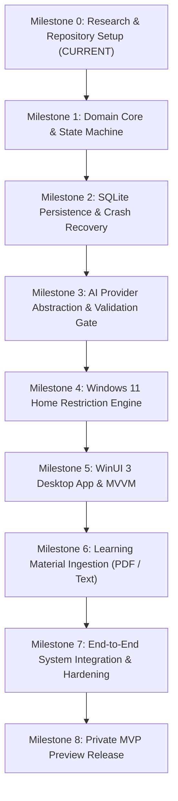

# SYNTRA — Implementation Roadmap

**Current Phase:** Milestone 0 (Planning & Setup)  
**Execution:** Milestone-Gated, Test-Driven Development  

---

## 1. Development Principles & Milestone Gates

SYNTRA follows a strict **architecture-first, zero-premature-code** policy.
- No code will be written in `src/` or `tests/` until **Milestone 0** is reviewed and approved by the user.
- Each milestone contains explicit **Dependencies**, **Deliverables**, **Acceptance Criteria**, **Testing Requirements**, **Security Checks**, and **Exit Criteria**.
- Progression from one milestone to the next requires satisfying all exit criteria and running automated verification suites.

---

## 2. Milestone Breakdown

---

### Milestone 0: Research, Architecture & Repository Setup (CURRENT)
- **Objective:** Establish the complete architectural foundation, verified technical constraints on Windows 11 Home, AI abstraction designs, threat modeling, and repository configurations.
- **Dependencies:** None.
- **Deliverables:**
  - Root architecture documents: `README.md`, `PROJECT_SPEC.md`, `ARCHITECTURE.md`, `IMPLEMENTATION_PLAN.md`, `WINDOWS_SECURITY.md`, `AI_AND_VERIFICATION.md`, `GITHUB_REUSE_AUDIT.md`, `DECISIONS.md`.
  - Comprehensive domain guides under `docs/` (Requirements, User Flows, UI Guidelines, DB Schema, AI Design, Threat Model, Privacy, Testing, Compatibility, Error Handling, Accessibility, Release Plan).
  - Repository configuration: `.gitignore`, Issue Templates, PR Template, Contributing Guide.
- **Acceptance Criteria:**
  - All documents are substantive, exhaustive, and interlinked with zero broken relative links.
  - Windows 11 Home restriction capabilities and limitations are verified against official Microsoft Learn documentation.
  - Open-source candidate repositories are forensically audited with verified licenses.
  - No application implementation code or fake tests are created.
- **Security Checks:**
  - Verify zero secrets, credentials, or private user data exist in the repository.
- **Exit Criteria:**
  - User reviews and approves Milestone 0 foundation.

---

### Milestone 1: Domain Core & Session State Machine
- **Objective:** Implement the pure .NET 8 domain layer, domain models, value objects, and the `SessionStateMachine`.
- **Dependencies:** Milestone 0 approval.
- **Deliverables:**
  - Project `src/Syntra.Core` targeting `net8.0` with zero external package dependencies.
  - Entities: `StudyProfile`, `StudyPlan`, `StudyTask`, `StudySession`, `Assessment`, `AssessmentAttempt`.
  - State Machine: `SessionStateMachine` enforcing states (`NotStarted`, `Ready`, `Active`, `Paused`, `TaskAssessment`, `TaskCompleted`, `SessionCompleted`, `EmergencyExit`, `RecoveryRequired`).
  - Core Ports: `IStudySessionRepository`, `IAiPlanningService`, `IAiAssessmentService`, `IWindowsRestrictionService`, `IClock`.
  - Test Suite: `tests/Syntra.Core.Tests` using `xUnit` and `FluentAssertions`.
- **Acceptance Criteria:**
  - State machine correctly executes all valid transitions.
  - State machine throws `InvalidSessionTransitionException` on any attempt to skip assessment or complete tasks on timer expiration alone.
  - Invariant rules (e.g. passing score threshold >= 80%) are strictly enforced.
- **Testing Requirements:**
  - 100% unit test branch coverage across `SessionStateMachine` and deterministic scoring rules.
- **Security Checks:**
  - Zero Windows API or Cloud AI dependencies in `Syntra.Core`.
- **Exit Criteria:**
  - All unit tests pass cleanly via `dotnet test tests/Syntra.Core.Tests`.

---

### Milestone 2: SQLite Persistence & Crash Recovery
- **Objective:** Implement local relational persistence using SQLite in WAL mode with transactional state snapshots and crash recovery queries.
- **Dependencies:** Milestone 1.
- **Deliverables:**
  - Project `src/Syntra.Data` targeting `net8.0`.
  - SQLite database initializer, schema creation scripts, and migration runner.
  - Repository implementations: `SqliteStudySessionRepository`, `SqliteProfileRepository`, `SqliteMaterialRepository`.
  - Transactional event logging (`session_events` audit table).
  - Test Suite: `tests/Syntra.Integration.Tests` testing data persistence against in-memory/temp SQLite databases.
- **Acceptance Criteria:**
  - Database operates in `journal_mode = WAL` with `synchronous = NORMAL`.
  - State transitions are committed to disk before returning to callers.
  - Recovery query accurately identifies orphaned `Active` or `TaskAssessment` sessions upon startup.
- **Testing Requirements:**
  - Simulated process kill during simulated transactions; verify zero database corruption.
- **Security Checks:**
  - Parameterized SQL queries only (via Dapper/Microsoft.Data.Sqlite); zero SQL injection attack surface.
- **Exit Criteria:**
  - Data integration tests pass with 100% schema consistency.

---

### Milestone 3: AI Provider Abstraction & Validation Gate
- **Objective:** Implement provider-neutral Cloud AI integration using `Microsoft.Extensions.AI`, JSON schema validation, and prompt injection defense.
- **Dependencies:** Milestone 1.
- **Deliverables:**
  - Project `src/Syntra.AI` targeting `net8.0`.
  - `Microsoft.Extensions.AI` connectors supporting `IChatClient` (OpenAI, Anthropic, Gemini, Azure).
  - Implementations: `AiPlanningService`, `AiAssessmentService`.
  - Strict JSON schemas for study plans and quiz assessments.
  - Delimiter fencing sanitizers (`<<<UNTRUSTED_STUDY_MATERIAL_START>>>`).
  - Test Suite: `tests/Syntra.AI.Tests` with mock `IChatClient`.
- **Acceptance Criteria:**
  - AI responses failing JSON schema or bounds checking trigger automatic retry or throw clean domain exceptions.
  - Prompt injection attacks in study texts fail to override system prompts or bypass scoring thresholds.
- **Testing Requirements:**
  - Contract tests against adversarial payloads containing jailbreak tokens.
- **Security Checks:**
  - API keys retrieved strictly from Windows `PasswordVault`; zero hardcoded secrets.
- **Exit Criteria:**
  - AI unit and contract test suites pass cleanly.

---

### Milestone 4: Windows 11 Home Restriction Engine
- **Objective:** Implement native Win32 distraction restriction mechanisms and emergency exit controls in `Syntra.Windows`.
- **Dependencies:** Milestone 1.
- **Deliverables:**
  - Project `src/Syntra.Windows` targeting `net8.0-windows10.0.19041.0`.
  - Implementation: `WindowsRestrictionService` implementing `IWindowsRestrictionService`.
  - Fullscreen borderless Topmost window (`WS_EX_TOPMOST`) for primary and secondary monitors.
  - WinEvent foreground monitor (`SetWinEventHook` on `EVENT_SYSTEM_FOREGROUND`).
  - Low-level keyboard hook (`SetWindowsHookEx` on `WH_KEYBOARD_LL`) suppressing `WinKey`, `Alt+Tab`, `Alt+Esc`, `Ctrl+Esc`.
  - Windows Restart Manager registration (`RegisterApplicationRestart`).
  - Emergency exit hatch handler (pass-phrase challenge + cool-down timer).
- **Acceptance Criteria:**
  - Hook suppresses targeted shortcuts without blocking necessary input in SYNTRA.
  - Emergency exit key sequence triggers transparent, reliable unlock within defined cool-down.
  - Non-destructive execution: zero modification of Safe Mode, GPO, or system files.
- **Testing Requirements:**
  - Hook latency test verifying callback completes in under 2 ms.
- **Security Checks:**
  - Operates strictly with standard user privileges; no administrator elevation required.
- **Exit Criteria:**
  - Verified stability on Windows 11 Home without system freeze or unrecoverable lockouts.

---

### Milestone 5: WinUI 3 Desktop App & MVVM Presentation
- **Objective:** Build the modern fluent desktop interface using WinUI 3 and Windows App SDK.
- **Dependencies:** Milestones 1, 2, 3, 4.
- **Deliverables:**
  - Project `src/Syntra.App` targeting `net8.0-windows10.0.19041.0`.
  - MVVM ViewModels: `DashboardViewModel`, `SessionViewModel`, `AssessmentViewModel`, `MaterialsViewModel`, `SettingsViewModel`.
  - Fluent XAML Views: Dark theme styling, high-contrast support, responsive layouts.
  - Dependency Injection setup via `Microsoft.Extensions.DependencyInjection`.
- **Acceptance Criteria:**
  - Clean MVVM separation; zero business logic in XAML code-behind.
  - WCAG 2.1 AA accessibility and UI Automation compliance.
  - Cold startup to interactive dashboard under 1.5 seconds.
- **Testing Requirements:**
  - ViewModel unit tests verifying commands and navigation flows.
- **Security Checks:**
  - Unpackaged / MSIX sandbox configuration verified.
- **Exit Criteria:**
  - Fully navigable UI operating against mocked and real core services.

---

### Milestone 6: Learning Material Ingestion Engine
- **Objective:** Implement local document parsing and semantic chunking for Markdown, Text, and PDF files.
- **Dependencies:** Milestone 1, 2.
- **Deliverables:**
  - Integration of `UglyToad.PdfPig` (Apache 2.0) in `Syntra.Core` or ingestion sub-module.
  - Document parser extracting plain text, titles, headings, and code blocks.
  - Semantic sliding-window chunker (1,500–2,500 tokens with 200-token overlap).
  - Error reporter recording parsing anomalies without fabricating missing text.
- **Acceptance Criteria:**
  - Successfully parses 100+ page academic textbooks in under 5 seconds.
  - Zero native DLL dependencies for PDF parsing.
- **Testing Requirements:**
  - Test suite with diverse PDF layouts (multi-column, tables, code listings).
- **Security Checks:**
  - Malformed PDF test vectors to verify parser does not crash or leak memory.
- **Exit Criteria:**
  - Ingestion pipeline achieves > 98% text fidelity on verified sample documents.

---

### Milestone 7: End-to-End System Integration & Hardening
- **Objective:** Wire all components together, perform end-to-end user journey validation, simulate crashes, and conduct security reviews.
- **Dependencies:** Milestones 1 through 6.
- **Deliverables:**
  - Complete end-to-end integration test suite (`Syntra.Integration.Tests`).
  - Crash recovery drill: simulated power loss / forced process kill during assessment.
  - Performance profiling (memory leak analysis, hook latency, CPU utilization).
  - Updated architectural and threat model documentation.
- **Acceptance Criteria:**
  - 100% pass rate across end-to-end user stories.
  - Zero data loss or improper completion on simulated crash recovery.
  - CPU usage remains < 1.0% and memory < 120 MB during active sessions.
- **Security Checks:**
  - Full STRIDE threat model verification pass.
- **Exit Criteria:**
  - System passes all quality, security, and performance gates.

---

### Milestone 8: Private MVP Preview Release
- **Objective:** Package the application for private personal testing on Windows 11 Home.
- **Dependencies:** Milestone 7.
- **Deliverables:**
  - Self-contained MSIX installer package or unpackaged release with Windows App SDK bootstrapper.
  - Setup and onboarding documentation.
  - Private distribution deployment instructions.
- **Acceptance Criteria:**
  - Installs cleanly on a clean Windows 11 Home test machine without developer tools.
  - Onboarding, material ingestion, planning, enforcement, and assessment execute smoothly.
- **Exit Criteria:**
  - User authorization for initial private testing.
