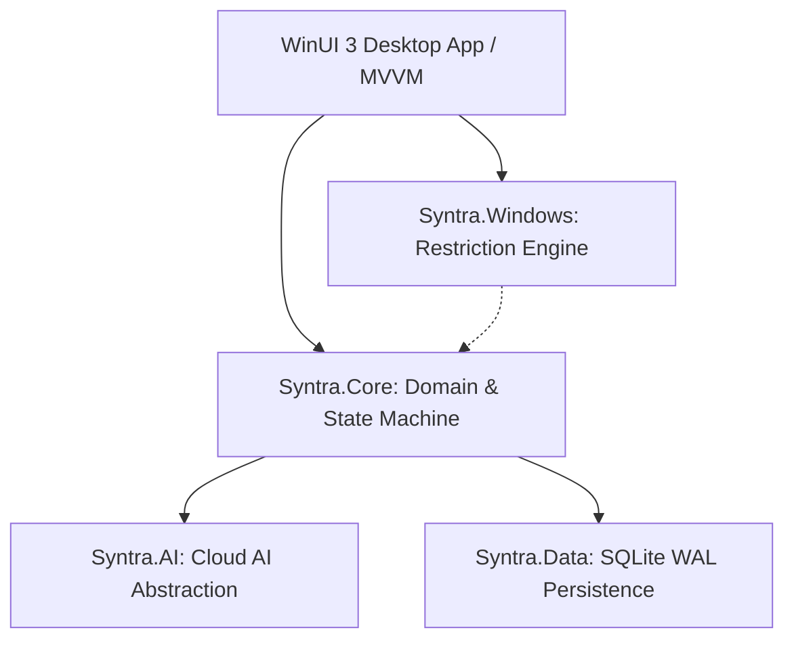

# SYNTRA

> **Focus. Learn. Prove it.**

An AI-driven Windows desktop study environment that builds adaptive study schedules, blocks desktop distractions, and unlocks only when you prove retention through tested recall.

---

### Project Status: Planning & Architecture (Milestone 0)
SYNTRA is currently in active planning and architectural specification. **There is no executable build or binary release yet.** Source code and test implementation will begin once architectural and security specs are fully reviewed.

---

## Why SYNTRA?

Most study and productivity tools on Windows have two glaring problems:
1. **Passive reading creates false confidence:** Highlighting notes or skimming textbooks gives the feeling of learning without retention.
2. **Honor-system timers are easy to game:** Pomodoro timers and simple app blockers count down whether you actually studied or spent the hour staring at tabs.

SYNTRA fixes both:
- **It builds structured study plans:** You provide textbooks, slides, or notes (PDF, Markdown, text). Cloud AI breaks them into sequential topics with prerequisite ordering, time estimates, and scheduled reviews.
- **It enforces focus on Windows 11 Home:** When a session starts, SYNTRA locks the desktop surface using native Win32 window management, a topmost borderless overlay, and low-level keyboard hooks (`WinKey`, `Alt+Tab`).
- **Comprehension unlocks the app, not the clock:** When reading finishes, you take an active-recall quiz (multiple-choice and short-answer). Pass with 80% or higher, and the desktop unlocks. Fail, and you get targeted review notes with a mandatory cool-down before retrying.

---

## How It Works

- **`Syntra.Core`**: Pure .NET 8 domain layer with zero UI or OS dependencies. Holds the session state machine, scoring rules, and completion logic. Fully unit-tested in isolation.
- **`Syntra.Windows`**: Win32 integration adapter (`SetWinEventHook`, `WH_KEYBOARD_LL`, `RegisterApplicationRestart`, `WS_EX_TOPMOST`). Manages overlays and blocks distraction shortcuts.
- **`Syntra.AI`**: Built on `Microsoft.Extensions.AI` (`IChatClient`). Connects to OpenAI, Anthropic, Gemini, or Azure with strict JSON schemas and delimiter-fenced prompt injection defenses.
- **`Syntra.Data`**: Local SQLite database running in Write-Ahead Logging (`WAL`) mode for crash-proof local state.
- **`Syntra.App`**: Windows 11 desktop UI built with WinUI 3 and Windows App SDK.

---

## Windows 11 Home & Security Limitations

SYNTRA runs as a standard user desktop application. It does not pretend to have operating system powers it cannot legally or technically possess:

- **No Enterprise Kiosk Features:** Windows Assigned Access and Shell Launcher are not available on Windows 11 Home (they require Pro or Enterprise editions). SYNTRA relies on user-mode window overlays and keyboard hooks.
- **No Kernel Rootkits or Drivers:** SYNTRA does not install kernel drivers, tamper with BIOS/UEFI, or intercept `Ctrl + Alt + Delete` (which is reserved by Windows Winlogon).
- **Restart & Crash Recovery:** If the app is killed or Windows reboots, SQLite WAL records ensure the session resumes on login without granting unearned completion.
- **Emergency Exit:** An emergency exit hatch (`Ctrl + Shift + F12`) allows immediate unlock via a 30-word confirmation challenge or a 3-minute cool-down, ensuring you never lock yourself out of your machine.

---

## Technical Specifications

| Parameter | Target |
|---|---|
| **OS Target** | Windows 11 Home (64-bit x64 / ARM64), 22H2 or newer |
| **Runtime** | .NET 8 LTS |
| **UI Platform** | WinUI 3 (Windows App SDK 1.5+) |
| **Local Storage** | SQLite 3 (WAL mode, parameterized SQL) |
| **AI Abstraction** | `Microsoft.Extensions.AI` (`IChatClient`) |
| **PDF Ingestion** | `UglyToad.PdfPig` (Pure C#, Apache 2.0) |
| **Memory Target** | < 120 MB RAM during active study |
| **Hook Latency** | < 1.0 ms callback execution |

---

## Documentation

### Core Specifications
- [PROJECT_SPEC.md](PROJECT_SPEC.md) — Requirements, use cases, acceptance criteria, and non-goals.
- [ARCHITECTURE.md](ARCHITECTURE.md) — System boundaries, data flow, state machine, and component design.
- [IMPLEMENTATION_PLAN.md](IMPLEMENTATION_PLAN.md) — Phased milestones from planning to v1.0 release.
- [WINDOWS_SECURITY.md](WINDOWS_SECURITY.md) — Windows 11 Home enforcement capabilities, Win32 hooks, and bypass analysis.
- [AI_AND_VERIFICATION.md](AI_AND_VERIFICATION.md) — AI abstraction, prompt injection defenses, JSON schemas, and deterministic scoring.
- [GITHUB_REUSE_AUDIT.md](GITHUB_REUSE_AUDIT.md) — Research notes on open-source projects, licenses, and architectural takeaways.
- [DECISIONS.md](DECISIONS.md) — Architectural Decision Records (ADRs 001–009).
- [.github/CONTRIBUTING.md](.github/CONTRIBUTING.md) — Contribution workflow and engineering standards.

### Engineering & Domain Guides (`docs/`)
- [Product Requirements](docs/PRODUCT_REQUIREMENTS.md) — Detailed feature requirements and edge cases.
- [User Flows](docs/USER_FLOWS.md) — End-to-end journey maps and state diagrams.
- [UI/UX Guidelines](docs/UI_UX_GUIDELINES.md) — WinUI 3 layout, dark palette, typography, and motion.
- [Database Schema](docs/DATABASE_SCHEMA.md) — Complete SQLite schema, indexes, and migration strategy.
- [AI Provider Design](docs/AI_PROVIDER_DESIGN.md) — Provider setup, prompt templates, and retry middleware.
- [Threat Model](docs/THREAT_MODEL.md) — STRIDE security assessment and attack surface mitigations.
- [Privacy Policy Draft](docs/PRIVACY_POLICY_DRAFT.md) — Data transparency, local storage, and AI transmission boundaries.
- [Testing Strategy](docs/TESTING_STRATEGY.md) — Unit, integration, schema, and performance test plans.
- [Windows Compatibility](docs/WINDOWS_COMPATIBILITY.md) — Multi-monitor, DPI scaling, and OS version support.
- [Error Handling](docs/ERROR_HANDLING.md) — Error taxonomy, backoff retry policies, and circuit breakers.
- [Accessibility](docs/ACCESSIBILITY.md) — WCAG 2.1 AA compliance, keyboard navigation, and UI Automation.
- [Release Plan](docs/RELEASE_PLAN.md) — MSIX packaging, code signing, and release milestones.

---

## Roadmap

```mermaid
flowchart LR
    M0["Milestone 0<br/>Planning & Setup<br/>(CURRENT)"] --> M1["Milestone 1<br/>Core Domain &<br/>State Machine"]
    M1 --> M2["Milestone 2<br/>SQLite Storage &<br/>Recovery Engine"]
    M2 --> M3["Milestone 3<br/>AI Abstraction &<br/>Schema Validation"]
    M3 --> M4["Milestone 4<br/>Windows Hooks &<br/>Overlay Engine"]
    M4 --> M5["Milestone 5<br/>WinUI 3 Desktop<br/>Interface"]
    M5 --> M6["Milestone 6<br/>PDF & Markdown<br/>Ingestion"]
    M6 --> M7["Milestone 7<br/>System Integration<br/>& Hardening"]
    M7 --> M8["Milestone 8<br/>Private MVP"]
```

