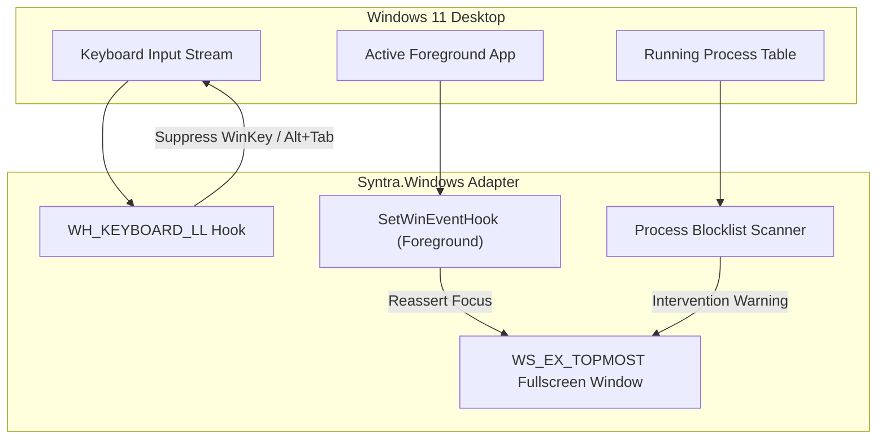

# Windows 11 Home Security & Enforcement Model

**Target OS:** Windows 11 Home (22H2 / 23H2 / 24H2)  
**Execution Context:** Standard User Mode (`asInvoker`)  

---

## 1. Operating System Boundary

SYNTRA is a standard user-mode desktop application. It does not install kernel drivers, disable Windows security features, or attempt to prevent administrative action.

On Windows NT, an administrator or physical machine owner always retains ultimate control:
- The Secure Attention Sequence (`Ctrl + Alt + Delete`) is handled directly by Windows Winlogon and the kernel executive. No user-mode app can intercept it.
- An administrator can always kill user processes using Task Manager or command-line tools (`taskkill /F`).
- A user can always physically power off the machine or boot into Safe Mode.

SYNTRA addresses this through **friction and persistent state**, not futile kernel lockouts:
1. It suppresses habitual distractions (`Alt+Tab`, `WinKey`, background app popups).
2. It commits state to SQLite WAL before any UI update.
3. If terminated or rebooted, it detects the uncompleted session on login and resumes enforcement.

---

## 2. Windows Edition Limitations: Home vs. Pro vs. Enterprise

Enterprise kiosk lockdown features were researched against official Microsoft Learn documentation (Verified October 2026):

| Feature | Windows 11 Home | Windows 11 Pro | Windows 11 Enterprise | SYNTRA Decision |
|---|:---:|:---:|:---:|---|
| **Assigned Access (Single-App Kiosk)** | ❌ Unsupported | ✅ Supported | ✅ Supported | **Cannot use.** Microsoft Learn explicitly excludes Windows 11 Home. |
| **Shell Launcher (Custom Shell Replacement)** | ❌ Unsupported | ❌ Unsupported | ✅ Supported | **Cannot use.** Requires Enterprise, Education, or IoT Enterprise. |
| **Group Policy (`gpedit.msc`)** | ❌ Unsupported | ✅ Supported | ✅ Supported | **Cannot use.** Home edition lacks local GPO management. |
| **AppLocker / WDAC Rules** | ❌ Unsupported | Partial | ✅ Supported | **Cannot use.** GPO-based application control unavailable on Home. |
| **Low-Level Keyboard Hook (`WH_KEYBOARD_LL`)** | ✅ Supported | ✅ Supported | ✅ Supported | **Adopted.** Intercepts `WinKey`, `Alt+Tab`, `Alt+Esc` in user space. |
| **WinEvent Supervision (`SetWinEventHook`)** | ✅ Supported | ✅ Supported | ✅ Supported | **Adopted.** Detects foreground focus changes in real time. |
| **Topmost Overlay (`WS_EX_TOPMOST`)** | ✅ Supported | ✅ Supported | ✅ Supported | **Adopted.** Fullscreen borderless window covers desktop surfaces. |
| **Restart Manager (`RegisterApplicationRestart`)** | ✅ Supported | ✅ Supported | ✅ Supported | **Adopted.** Native reboot and crash recovery registration. |

### Microsoft Learn Primary Sources
- *Assigned Access Requirements:* `https://learn.microsoft.com/windows/configuration/assigned-access/`
- *Shell Launcher Requirements:* `https://learn.microsoft.com/windows/configuration/kiosk-shelllauncher`
- *RegisterApplicationRestart API:* `https://learn.microsoft.com/windows/win32/api/winbase/nf-winbase-registerapplicationrestart`

---

## 3. Enforcement Implementation

Because enterprise kiosk APIs are absent on Windows 11 Home, `Syntra.Windows` implements a four-tier user-mode restriction model:

### 1. Fullscreen Topmost Surface (`WS_EX_TOPMOST`)
- Displays a borderless WinUI 3 window positioned at `(0, 0, ScreenWidth, ScreenHeight)`.
- Multi-monitor setups: enumerates displays via `EnumDisplayMonitors` and places darkened companion overlay windows across all secondary screens.

### 2. Low-Level Keyboard Hook (`WH_KEYBOARD_LL`)
- Registered via `SetWindowsHookEx(WH_KEYBOARD_LL, ...)`.
- Suppresses:
  - `VK_LWIN` and `VK_RWIN` (Windows Key).
  - `Alt + Tab` (Task switcher).
  - `Alt + Esc` (Window cycling).
  - `Ctrl + Esc` (Start menu).
- Performance requirement: callback completes in under 0.5 ms to avoid triggering the Windows `LowLevelHooksTimeout` watchdog.

### 3. Foreground Window Supervision (`SetWinEventHook`)
- Registered on `EVENT_SYSTEM_FOREGROUND`.
- If an unapproved application steals focus (e.g. background notification or launcher), SYNTRA calls `SetForegroundWindow()` and `BringWindowToTop()` to bring the study view back to the front.

### 4. Process Blocklist Inspector
- Periodically (every 2.5s) queries running processes using `CreateToolhelp32Snapshot`.
- Checks against common game and entertainment executables (Steam, Discord, Spotify, Battle.net).
- If detected, displays an intervention dialog stating that the blacklisted app must be closed.

---

## 4. Threat & Bypass Handling

| Bypass Vector | Preventable in User Mode? | SYNTRA Handling |
|---|:---:|---|
| **`Ctrl + Alt + Delete`** | ❌ No | Windows Security screen is OS-level. When the user returns to the desktop, `SetWinEventHook` re-engages and reasserts focus. |
| **Task Manager Kill** | ❌ No | State is committed to SQLite WAL before each transition. On reboot/relaunch, the incomplete session is detected and resumed. |
| **Physical Reboot / Power Off** | ❌ No | `RegisterApplicationRestart` and Startup registry entries launch SYNTRA into `RecoveryRequired` state on login. |
| **Secondary Device Distraction** | ❌ No | Explicit non-goal. We do not use invasive webcams or gaze tracking. |
| **Safe Mode Boot** | ❌ No | SYNTRA does not alter Safe Mode settings. Safe Mode remains the administrative recovery option for the computer owner. |

---

## 5. Emergency Exit Protocol

A locking app without an emergency escape hatch is unsafe. SYNTRA provides two exit mechanisms:

### 1. In-App Emergency Passphrase
- Pressing `Ctrl + Shift + F12` opens the emergency exit modal.
- To prevent impulsive unlocks while allowing deliberate exits, the user must type a 30-word random confirmation phrase or wait out a 3-minute cool-down timer.
- On confirmation:
  - All hooks are uninstalled immediately.
  - The overlay is closed.
  - State machine transitions to `EmergencyExit`.
  - The exit event and timestamp are permanently written to `session_events`.

### 2. Standard User Account Strategy (Optional Setup)
For users who want hardware-level discipline:
1. Create a secondary standard Windows account named `Study`.
2. The primary account remains the administrator with a long, stored password.
3. Standard accounts cannot kill processes owned by other users or uninstall applications.
