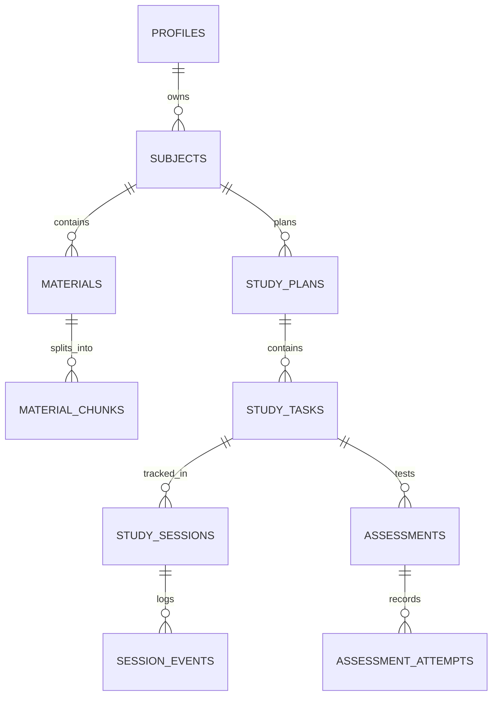

# SYNTRA — SQLite Database Schema & Persistence Design

**Engine:** SQLite 3 (via `Microsoft.Data.Sqlite`)  
**Journal Mode:** Write-Ahead Logging (`WAL`)  
**Integrity Model:** Immediate ACID Transactional Commit  

---

## 1. Relational Entity Architecture



---

## 2. Pragmas & Connection Configuration

Every connection initialized by `Syntra.Data` executes the following initialization sequence:

```sql
PRAGMA journal_mode = WAL;
PRAGMA synchronous = NORMAL;
PRAGMA foreign_keys = ON;
PRAGMA busy_timeout = 5000;
PRAGMA auto_vacuum = INCREMENTAL;
```

---

## 3. Data Definition Language (DDL)

```sql
-- -----------------------------------------------------------------------------
-- 1. Profiles Table
-- Stores user identity, session cadence, and enforcement preferences.
-- -----------------------------------------------------------------------------
CREATE TABLE IF NOT EXISTS profiles (
    id TEXT PRIMARY KEY NOT NULL,
    display_name TEXT NOT NULL,
    default_study_minutes INTEGER NOT NULL DEFAULT 45,
    default_break_minutes INTEGER NOT NULL DEFAULT 10,
    enforcement_mode TEXT NOT NULL DEFAULT 'Standard', -- 'Standard', 'Strict'
    allow_emergency_exit INTEGER NOT NULL DEFAULT 1,
    daily_goal_minutes INTEGER NOT NULL DEFAULT 180,
    created_at_utc TEXT NOT NULL,
    updated_at_utc TEXT NOT NULL
);

-- -----------------------------------------------------------------------------
-- 2. Subjects Table
-- Primary domain subjects (e.g. "Distributed Systems", "Biochemistry").
-- -----------------------------------------------------------------------------
CREATE TABLE IF NOT EXISTS subjects (
    id TEXT PRIMARY KEY NOT NULL,
    profile_id TEXT NOT NULL,
    name TEXT NOT NULL,
    description TEXT,
    target_completion_date TEXT,
    color_hex TEXT NOT NULL DEFAULT '#388BFD',
    created_at_utc TEXT NOT NULL,
    FOREIGN KEY (profile_id) REFERENCES profiles(id) ON DELETE CASCADE
);

-- -----------------------------------------------------------------------------
-- 3. Materials Table
-- Ingested files (PDFs, Markdown, Text).
-- -----------------------------------------------------------------------------
CREATE TABLE IF NOT EXISTS materials (
    id TEXT PRIMARY KEY NOT NULL,
    subject_id TEXT NOT NULL,
    title TEXT NOT NULL,
    original_file_path TEXT NOT NULL,
    file_format TEXT NOT NULL, -- 'pdf', 'md', 'txt'
    file_size_bytes INTEGER NOT NULL,
    total_token_count INTEGER NOT NULL DEFAULT 0,
    ingestion_status TEXT NOT NULL DEFAULT 'Processed', -- 'Pending', 'Processed', 'Failed'
    sha256_hash TEXT NOT NULL,
    created_at_utc TEXT NOT NULL,
    FOREIGN KEY (subject_id) REFERENCES subjects(id) ON DELETE CASCADE
);

-- -----------------------------------------------------------------------------
-- 4. Material Chunks Table
-- Semantic text slices (1,500 - 2,500 tokens) with overlap.
-- -----------------------------------------------------------------------------
CREATE TABLE IF NOT EXISTS material_chunks (
    id TEXT PRIMARY KEY NOT NULL,
    material_id TEXT NOT NULL,
    chunk_index INTEGER NOT NULL,
    start_char_offset INTEGER NOT NULL,
    end_char_offset INTEGER NOT NULL,
    token_count INTEGER NOT NULL,
    content_text TEXT NOT NULL,
    summary_text TEXT,
    FOREIGN KEY (material_id) REFERENCES materials(id) ON DELETE CASCADE
);

-- -----------------------------------------------------------------------------
-- 5. Study Plans Table
-- AI-synthesized curriculum plans.
-- -----------------------------------------------------------------------------
CREATE TABLE IF NOT EXISTS study_plans (
    id TEXT PRIMARY KEY NOT NULL,
    subject_id TEXT NOT NULL,
    title TEXT NOT NULL,
    version INTEGER NOT NULL DEFAULT 1,
    is_active INTEGER NOT NULL DEFAULT 1,
    raw_ai_payload_json TEXT NOT NULL,
    created_at_utc TEXT NOT NULL,
    FOREIGN KEY (subject_id) REFERENCES subjects(id) ON DELETE CASCADE
);

-- -----------------------------------------------------------------------------
-- 6. Study Tasks Table
-- Discrete study units requiring reading and assessment.
-- -----------------------------------------------------------------------------
CREATE TABLE IF NOT EXISTS study_tasks (
    id TEXT PRIMARY KEY NOT NULL,
    study_plan_id TEXT NOT NULL,
    topic_name TEXT NOT NULL,
    subtopic_name TEXT NOT NULL,
    task_order INTEGER NOT NULL,
    estimated_minutes INTEGER NOT NULL,
    learning_objectives_json TEXT NOT NULL,
    prerequisite_task_id TEXT,
    is_completed INTEGER NOT NULL DEFAULT 0,
    completed_at_utc TEXT,
    FOREIGN KEY (study_plan_id) REFERENCES study_plans(id) ON DELETE CASCADE,
    FOREIGN KEY (prerequisite_task_id) REFERENCES study_tasks(id) ON DELETE SET NULL
);

-- -----------------------------------------------------------------------------
-- 7. Study Sessions Table
-- Real-time study session state tracking.
-- -----------------------------------------------------------------------------
CREATE TABLE IF NOT EXISTS sessions (
    id TEXT PRIMARY KEY NOT NULL,
    task_id TEXT NOT NULL,
    current_state TEXT NOT NULL, -- 'Ready', 'Active', 'Paused', 'TaskAssessment', 'TaskCompleted', 'SessionCompleted', 'EmergencyExit', 'RecoveryRequired'
    started_at_utc TEXT NOT NULL,
    completed_at_utc TEXT,
    elapsed_active_seconds INTEGER NOT NULL DEFAULT 0,
    pause_count INTEGER NOT NULL DEFAULT 0,
    termination_reason TEXT,
    FOREIGN KEY (task_id) REFERENCES study_tasks(id) ON DELETE CASCADE
);

-- -----------------------------------------------------------------------------
-- 8. Session Events Audit Table
-- Immutable event ledger for crash recovery and audit trails.
-- -----------------------------------------------------------------------------
CREATE TABLE IF NOT EXISTS session_events (
    id INTEGER PRIMARY KEY AUTOINCREMENT,
    session_id TEXT NOT NULL,
    event_type TEXT NOT NULL, -- 'StateTransition', 'BreachAttempt', 'EmergencyExit', 'CrashRecovery'
    from_state TEXT,
    to_state TEXT,
    details_json TEXT,
    timestamp_utc TEXT NOT NULL,
    FOREIGN KEY (session_id) REFERENCES sessions(id) ON DELETE CASCADE
);

-- -----------------------------------------------------------------------------
-- 9. Assessments Table
-- AI-generated assessment schemas attached to tasks.
-- -----------------------------------------------------------------------------
CREATE TABLE IF NOT EXISTS assessments (
    id TEXT PRIMARY KEY NOT NULL,
    task_id TEXT NOT NULL,
    passing_score_percentage REAL NOT NULL DEFAULT 80.0,
    questions_schema_json TEXT NOT NULL,
    created_at_utc TEXT NOT NULL,
    FOREIGN KEY (task_id) REFERENCES study_tasks(id) ON DELETE CASCADE
);

-- -----------------------------------------------------------------------------
-- 10. Assessment Attempts Table
-- Every quiz submission, score breakdown, and cryptographic proof hash.
-- -----------------------------------------------------------------------------
CREATE TABLE IF NOT EXISTS assessment_attempts (
    id TEXT PRIMARY KEY NOT NULL,
    assessment_id TEXT NOT NULL,
    session_id TEXT NOT NULL,
    attempt_number INTEGER NOT NULL,
    mcq_score_percentage REAL NOT NULL,
    short_answer_score_percentage REAL NOT NULL,
    composite_score_percentage REAL NOT NULL,
    is_passed INTEGER NOT NULL, -- 1 if composite >= 80.0, else 0
    submitted_answers_json TEXT NOT NULL,
    ai_feedback_json TEXT,
    evidence_hmac_hash TEXT NOT NULL,
    created_at_utc TEXT NOT NULL,
    FOREIGN KEY (assessment_id) REFERENCES assessments(id) ON DELETE CASCADE,
    FOREIGN KEY (session_id) REFERENCES sessions(id) ON DELETE CASCADE
);
```

---

## 4. Performance Indexes

```sql
CREATE INDEX IF NOT EXISTS idx_materials_subject ON materials(subject_id);
CREATE INDEX IF NOT EXISTS idx_material_chunks_material ON material_chunks(material_id);
CREATE INDEX IF NOT EXISTS idx_study_tasks_plan ON study_tasks(study_plan_id, task_order);
CREATE INDEX IF NOT EXISTS idx_sessions_active ON sessions(current_state) WHERE current_state IN ('Active', 'TaskAssessment', 'Paused');
CREATE INDEX IF NOT EXISTS idx_session_events_session ON session_events(session_id, timestamp_utc);
CREATE INDEX IF NOT EXISTS idx_assessment_attempts_assessment ON assessment_attempts(assessment_id, is_passed);
```

---

## 5. Schema Migration & Versioning Strategy

Database versioning is tracked via SQLite's native PRAGMA:
```sql
PRAGMA user_version;
```
When `Syntra.Data` boots:
1. Queries `PRAGMA user_version;`.
2. Compares against `TargetSchemaVersion` (v1).
3. If `user_version < 1`, executes DDL migration scripts inside an atomic transaction.
4. Updates `PRAGMA user_version = 1;`.
