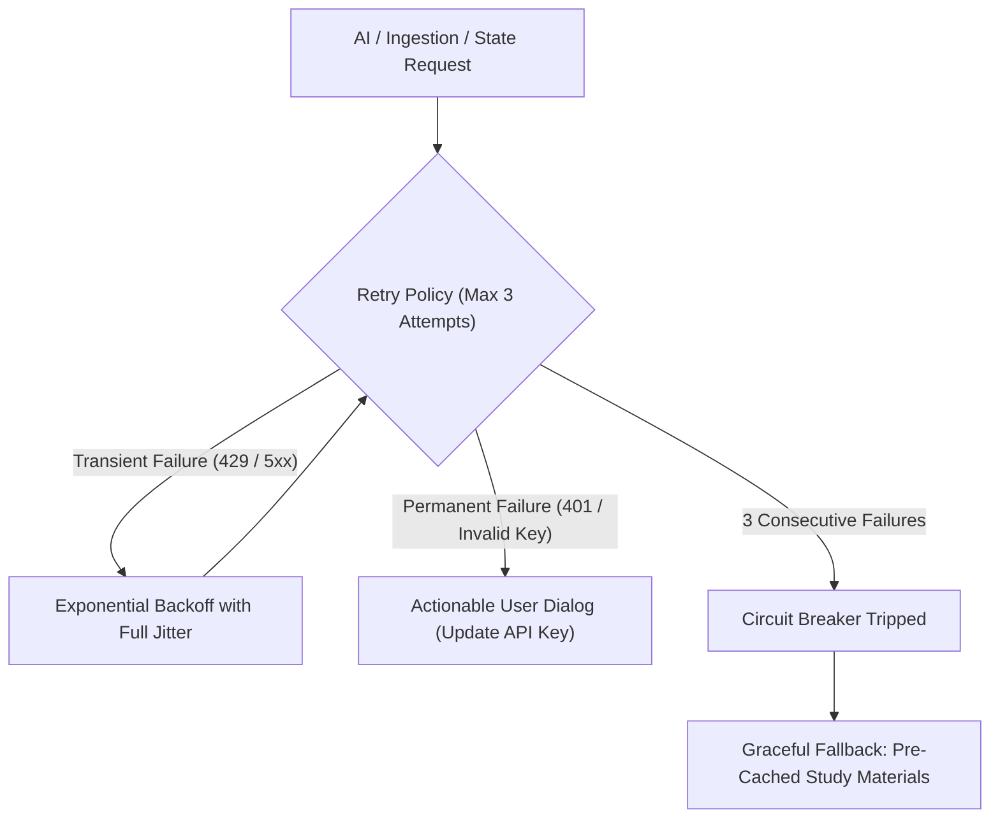

# SYNTRA — Error Handling & Resilience Architecture

---

## 1. Error Taxonomy & Classification

SYNTRA categorizes all potential system failures into five distinct domains:

| Category | Typical Scenarios | Severity | Recovery Strategy |
|---|---|:---:|---|
| **Domain State Machine Errors** | Invalid transition requests; unearned completion attempts. | Critical | Immediate transition rejection; log tamper alert in `session_events`. |
| **Material Ingestion Errors** | Corrupt PDF streams; malformed Markdown; unsupported encodings. | Medium | Mark material as `Failed`; log error details; prompt user to re-import clean file. |
| **Cloud AI Provider Errors** | HTTP 429 (Rate Limit); HTTP 503; network timeout; JSON schema violation. | Medium | 3-stage exponential backoff with jitter; automatic prompt correction; offline fallback. |
| **Win32 Hook & Overlay Errors** | Hook registration failure; multi-monitor geometry change error. | High | Fail safe: unhook gracefully; alert user; transition to `EmergencyExit` if unsafe. |
| **SQLite Persistence Errors** | Database file locked (`SQLITE_BUSY`); disk full. | Critical | 5,000 ms busy-timeout retry; crash recovery restore upon reboot. |

---

## 2. Resilience Patterns



### 1. Jittered Exponential Backoff
For transient Cloud AI API errors (HTTP 429, 500, 502, 503, 504):
$$\text{Delay}(n) = \min\left(10\,\text{s},\; 1.5\,\text{s} \times 2^{n}\right) \pm \text{RandomJitter}(0, 500\,\text{ms})$$

### 2. Structured AI Schema Self-Correction
If Cloud AI returns a JSON response that fails schema validation or bounds checking:
1. `Syntra.AI` extracts the specific deserialization error (e.g. *"Property 'options' must have exactly 4 items, but had 3"*).
2. Dispatches an immediate correction request:
   ```
   Your previous response was invalid. 
   Validation Error: Property 'options' must have exactly 4 items, but had 3.
   Please re-output the complete JSON schema adhering strictly to all requirements.
   ```
3. If the second attempt fails, falls back to pre-generated offline review questions or allows reading continuation.

### 3. SQLite Busy-Timeout & WAL Concurrency
In high-frequency logging scenarios, SQLite connections can encounter file locks. SYNTRA configures:
```csharp
var connection = new SqliteConnection("Data Source=syntra.db;Mode=ReadWriteCreate;Cache=Shared");
// PRAGMA busy_timeout = 5000;
```
Ensures threads wait up to 5 seconds for write locks to clear before throwing an exception.

---

## 4. User-Facing Error Principles

1. **No Raw Stack Traces:** Technical stack traces and internal exception messages are logged to the local diagnostic log, never displayed directly in user dialogs.
2. **Action-Oriented Messaging:** Error dialogs always present a clear remedy:
   - *Bad:* `"System.Net.Http.HttpRequestException: 401 Unauthorized."`
   - *Good:* `"Cloud AI Authentication Failed. Your API key appears to be invalid. Would you like to update your API key in Settings?"`
3. **Safe State Preservation:** An unexpected error never causes unearned completion or loss of recorded study time.
