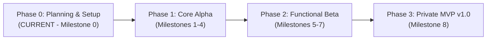

# SYNTRA — Release & Deployment Plan

**Platform:** Windows 11 Home (x64 / ARM64)  
**Distribution:** Private Desktop Application  

---

## 1. Release Lifecycle & Governance

SYNTRA follows a four-stage release lifecycle governed by strict quality gates:



| Phase | Target Artifact | Audience | Gating Criteria |
|---|---|---|---|
| **Phase 0: Planning & Setup** | Repository, ADRs, PRD, Security Docs | Engineering / Owner | All foundational docs approved; zero code written. |
| **Phase 1: Core Alpha** | Unit Test Suite & CLI Harness | Core Developer | 100% Core domain test pass; Win32 hooks validated on test PC. |
| **Phase 2: Functional Beta** | WinUI 3 Desktop Build (Unpackaged) | Owner / Alpha Tester | Complete end-to-end user flows (Ingestion ➔ Planning ➔ Assessment). |
| **Phase 3: Private MVP v1.0** | Self-Contained MSIX Installer | Project Owner | Full crash recovery drill passed; 0 unearned unlocks; WCAG AA verified. |

---

## 2. Packaging & Delivery Architecture

For Windows 11 Home, SYNTRA prepares two distinct packaging targets:

### 1. Primary Target: MSIX Package
- **Format:** Modern Windows App Package (`.msix`).
- **Benefits:** Clean install/uninstall, automatic dependency management (bundles Windows App SDK runtime), isolated registry, automatic tile and protocol registration.
- **Signing:** Signed with a local developer root certificate installed in `Cert:\CurrentUser\TrustedPeople` during private testing.

### 2. Secondary Target: Self-Contained Unpackaged Distribution
- **Format:** Standalone `.zip` archive containing `syntra.exe` compiled with:
  ```bash
  dotnet publish src/Syntra.App/Syntra.App.csproj \
    -c Release \
    -r win-x64 \
    --self-contained true \
    -p:WindowsAppSDKSelfContained=true
  ```
- **Benefits:** Zero prerequisite installation required; runs directly from folder on any clean Windows 11 machine without developer mode enabled.

---

## 3. Code Signing & Trust Strategy

On Windows 11 Home, SmartScreen flags unsigned executables with warnings.
- **Private Alpha / MVP Phase:**
  - Generate a dedicated developer test certificate via PowerShell:
    ```powershell
    New-SelfSignedCertificate -Type Custom -Subject "CN=SyntraDev" `
      -KeyUsage DigitalSignature -FriendlyName "SYNTRA Development Certificate" `
      -CertStoreLocation "Cert:\CurrentUser\My"
    ```
  - Export and install certificate to `Cert:\CurrentUser\TrustedPeople`.
  - Sign MSIX packages via `SignTool.exe`.
- **Future Public Distribution Phase:**
  - Transition to Microsoft Azure Trusted Signing (formerly Azure Code Signing) or an EV (Extended Validation) code signing certificate to achieve instant SmartScreen reputation.

---

## 4. Release Checklist & Rollout Verification

Before any private MVP release build is distributed:

- [ ] **Clean Build:** `dotnet build -c Release` completes with `0 Warnings, 0 Errors`.
- [ ] **Automated Tests:** All unit, contract, and integration tests pass cleanly via `dotnet test`.
- [ ] **Secret Hygiene Audit:** Verify zero API keys, personal documents, or passwords exist in binaries or configs.
- [ ] **Clean Uninstall Test:** Verify uninstalling removes all local database files and releases `RegisterApplicationRestart` entries.
- [ ] **Crash Recovery Drill:** Simulate forced termination (`taskkill /F /IM syntra.exe`) during an active study task and verify seamless restart recovery upon relaunch.
- [ ] **Emergency Exit Drill:** Verify that pressing `Ctrl+Shift+F12` and completing the passphrase challenge unhooks all restrictions and restores the desktop.
