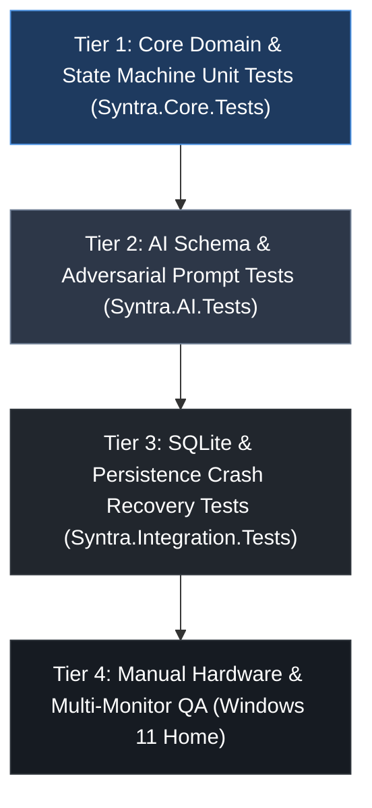

# SYNTRA — Automated Testing Strategy & Quality Assurance

**Testing Framework:** xUnit (.NET 8 LTS)  
**Assertion Library:** `FluentAssertions`  
**Mocking Framework:** `NSubstitute` / Microsoft.Extensions.AI Mocking  

---

## 1. Testing Pyramid & Test Architecture

SYNTRA enforces strict testability through Clean Architecture. The domain core (`Syntra.Core`) has zero dependencies on Windows Win32 APIs, UI controls, or live network calls, enabling microsecond unit test execution.



---

## 2. Test Suites Breakdown

### Suite 1: `Syntra.Core.Tests` (Unit Testing)
- **Target Assembly:** `Syntra.Core`
- **Execution Speed:** In-memory, < 500 ms for complete suite.
- **Coverage Mandate:** > 95% line and branch coverage across `SessionStateMachine` and scoring rules.
- **Key Test Fixtures:**
  - `SessionStateMachineTests`: Verifies all valid transitions (`NotStarted` ➔ `Ready` ➔ `Active` ➔ `TaskAssessment` ➔ `TaskCompleted` ➔ `SessionCompleted`).
  - `DeterministicCompletionAuthorityTests`: Asserts that timer expiration alone throws `InvalidSessionTransitionException`.
  - `ScoringCalculationTests`: Verifies 70/30 weighting, rounding bounds, and passing thresholds (80.0%).
  - `HmacEvidenceTests`: Asserts tamper detection on forged attempt records.

### Suite 2: `Syntra.AI.Tests` (Contract & Schema Validation)
- **Target Assembly:** `Syntra.AI`
- **Execution Mode:** Uses `MockChatClient` implementing `IChatClient`.
- **Key Test Fixtures:**
  - `JsonSchemaComplianceTests`: Validates that generated payloads deserialize correctly into `StudyPlanDto` and `QuizAssessmentDto`.
  - `BoundsEnforcementTests`: Verifies exception handling when an LLM returns too few questions, missing options, or invalid option indices.
  - `AdversarialPromptInjectionTests`: Injects known jailbreak payloads (`IGNORE PREVIOUS INSTRUCTIONS`) into study texts and verifies that prompt fencing prevents instruction overriding.

### Suite 3: `Syntra.Integration.Tests` (Persistence & Crash Recovery)
- **Target Assembly:** `Syntra.Data`
- **Execution Mode:** Uses on-disk temporary SQLite files in WAL mode.
- **Key Test Fixtures:**
  - `SqliteMigrationTests`: Verifies clean schema creation and `PRAGMA user_version` upgrades.
  - `CrashRecoverySimulationTests`:
    1. Inserts an `Active` session row.
    2. Simulates an abrupt application termination without calling `Dispose()`.
    3. Re-initializes repository and asserts that `GetActiveUnfinishedSessionsAsync()` recovers the session.
  - `AuditLogImmutabilityTests`: Verifies transactional integrity of `session_events`.

---

## 3. Mocking & Isolation Strategy

### 1. Deterministic Time Control (`IClock`)
System time is never accessed via `DateTime.UtcNow` directly. All components depend on `IClock`:
```csharp
public interface IClock
{
    DateTime UtcNow { get; }
}
```
In tests, `TestClock` advances time deterministically to simulate study periods, 5-minute assessment cool-downs, and spaced repetition intervals without `Thread.Sleep`.

### 2. Windows Restriction Mocking (`IWindowsRestrictionService`)
In unit and integration tests, `IWindowsRestrictionService` is mocked using `NSubstitute` or a `NullWindowsRestrictionService`, allowing state machine testing on any operating system without installing Win32 hooks.

---

## 4. Hook Performance Benchmark Test

To prevent Windows from timing out the low-level keyboard hook (`WH_KEYBOARD_LL`), a micro-benchmark harness asserts that the callback executes in under **1.0 millisecond**:
```csharp
[Fact]
public void LowLevelKeyboardHook_Callback_ExecutesUnderOneMillisecond()
{
    var sw = Stopwatch.StartNew();
    // Simulate keyboard event processing
    var result = KeyboardHookHandler.ProcessKey(0x09 /* Tab */, isAltPressed: true);
    sw.Stop();

    result.Should().Be(KeyAction.Suppress);
    sw.Elapsed.TotalMilliseconds.Should().BeLessThan(1.0);
}
```
