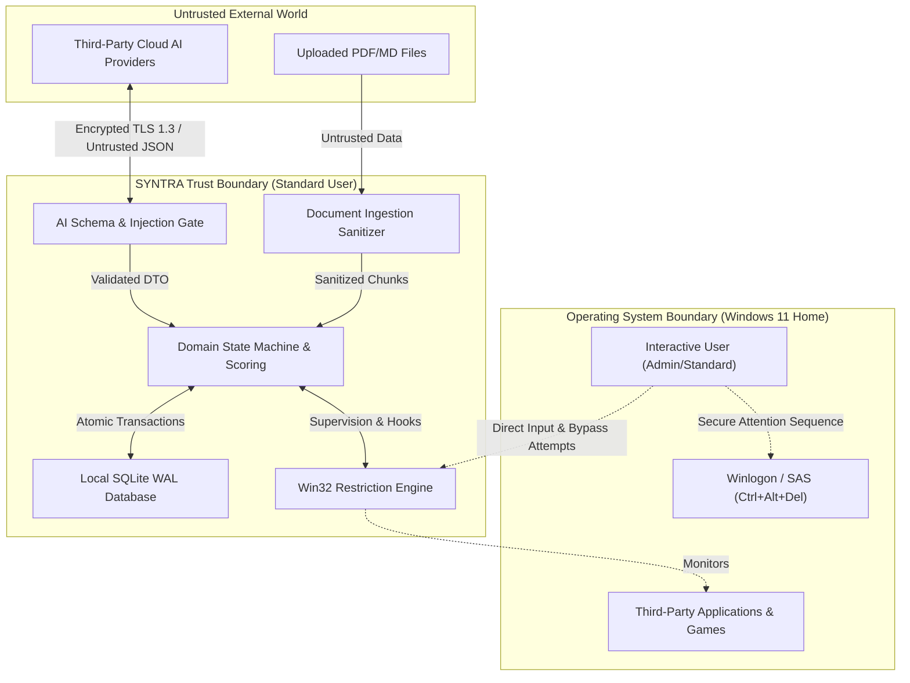

# SYNTRA — Threat Model & Security Notes

**Model:** STRIDE Analysis  
**Boundary:** Local-First Windows 11 Desktop with Cloud AI Boundary    

---

## 1. Trust Boundaries & Attack Surfaces

---

## 2. STRIDE Threat Analysis

### 1. Spoofing
- **Threat T-1: Faking Passing Assessment Results:** An attacker or tech-savvy student attempts to inject a fake passing score into the local database to unlock the app without studying.
  - *Impact:* High (integrity failure).
  - *Mitigation:* Every passing attempt requires a valid HMAC-SHA256 evidence hash calculated by `Syntra.Core` combining `TaskId`, `Timestamp`, and `FinalScore`. If the hash in the database does not match the computed hash of the attempt record, the state machine rejects completion.
- **Threat T-2: AI Endpoint Spoofing / Man-in-the-Middle:** Intercepting AI requests to return pre-cooked passing grades.
  - *Mitigation:* Strict HTTPS with certificate validation (TLS 1.3). No plain HTTP connections.

### 2. Tampering
- **Threat T-3: Prompt Injection via Ingested Study Materials:** A student downloads a syllabus or textbook containing hidden jailbreak instructions intended to force the AI to return 100% scores.
  - *Mitigation:* Clear separation of system and user messages. Fencing all material within `<<<UNTRUSTED_STUDY_MATERIAL_START>>>` delimiters. Independent deterministic local MCQ scoring where the LLM does not perform grading.
- **Threat T-4: Local SQLite State Tampering:** Manually modifying `sessions.current_state` from `Active` to `TaskCompleted` using a SQLite GUI tool while the app is closed.
  - *Mitigation:* On boot, the state machine validates that any `TaskCompleted` state has a corresponding matching record in `assessment_attempts` with a valid HMAC evidence hash. Inconsistent records force the session into `RecoveryRequired`.

### 3. Repudiation
- **Threat T-5: Claiming Accidental or Unrecorded Emergency Exit:** Denying that an emergency exit was triggered.
  - *Mitigation:* `session_events` audit table records immutable, timestamped entries for every emergency exit attempt, complete with the entered passphrase or cool-down wait time.

### 4. Information Disclosure
- **Threat T-6: Leakage of Cloud AI API Keys:** Committing API keys to source control or storing them in plain text configuration files.
  - *Mitigation:* API keys are never stored in source code or `appsettings.json`. Keys are stored in the Windows Credential Locker (`Windows.Security.Credentials.PasswordVault`).
- **Threat T-7: Eavesdropping on Study Content:** Transmission of sensitive private learning notes to untrusted destinations.
  - *Mitigation:* Communication occurs strictly with the user-configured AI endpoint over encrypted TLS. No background telemetry or analytics are collected or transmitted.

### 5. Denial of Service
- **Threat T-8: Malformed PDF Parser Crash:** Specially crafted PDFs containing deeply nested objects or recursive streams designed to crash the application.
  - *Mitigation:* `UglyToad.PdfPig` executes in a sandboxed parsing block with strict memory allocation limits and timeout guards. File parsing failures are caught and recorded as `IngestionStatus.Failed` without crashing the app.
- **Threat T-9: Hook Lockout / System Freeze:** A bug in the low-level keyboard hook callback deadlocking the Windows message queue.
  - *Mitigation:* Hook callbacks execute in < 0.5 ms with zero I/O. Windows `LowLevelHooksTimeout` automatically unhooks unresponsive hooks. The emergency exit hotkey (`Ctrl+Shift+F12`) provides an immediate release hatch.

### 6. Elevation of Privilege
- **Threat T-10: Running as Administrator / System Tampering:** Attempting to run SYNTRA as `SYSTEM` or installing kernel drivers to achieve absolute lockdown.
  - *Mitigation:* Explicit non-goal. SYNTRA manifests `requestedExecutionLevel` as `asInvoker`. It requires zero elevated privileges and avoids modifying system recovery or operating system security features.

---

## 3. Mitigation Summary Matrix

| Threat ID | Category | Risk Level | Primary Defense | Verification Method |
|---|---|:---:|---|---|
| **T-1** | Spoofing | High | HMAC evidence verification in `Syntra.Core`. | Automated unit tests simulating forged rows. |
| **T-3** | Tampering | High | Prompt delimiter fencing & deterministic local MCQ grading. | Adversarial prompt injection test suite in `Syntra.AI.Tests`. |
| **T-4** | Tampering | Medium | Cross-table audit check on application startup. | Database recovery integration tests. |
| **T-6** | Disclosure | High | Windows Credential Locker (`PasswordVault`). | Static analysis secret scanning in CI. |
| **T-8** | DoS | Medium | Pure C# memory-safe parsing with boundary guards. | Fuzz testing with malformed PDF files. |
| **T-9** | DoS | High | In-app emergency passphrase hatch (`Ctrl+Shift+F12`). | End-to-end emergency exit drill. |
