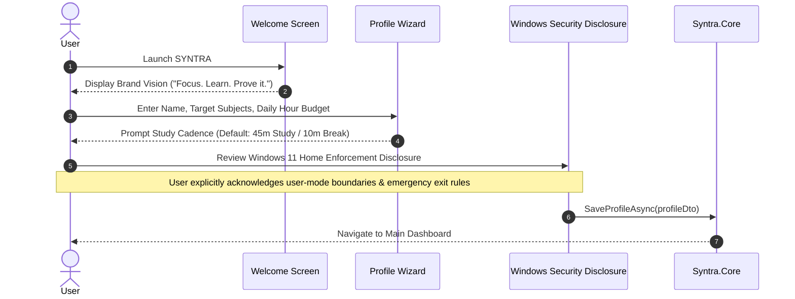
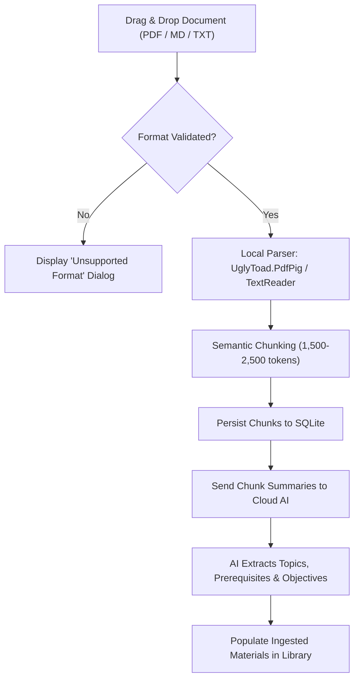
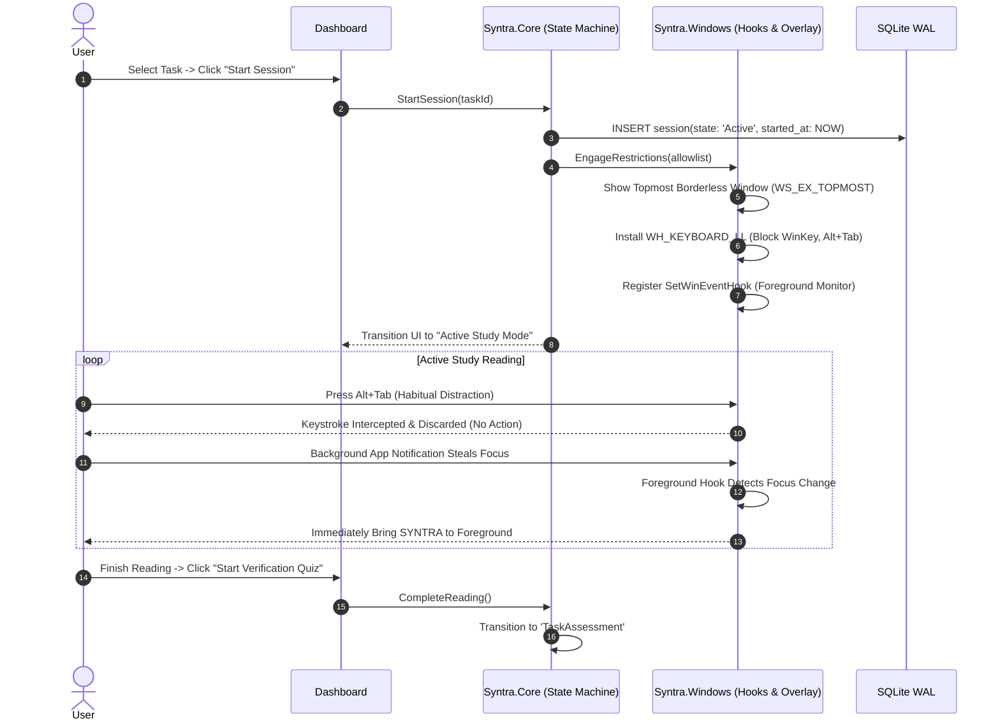
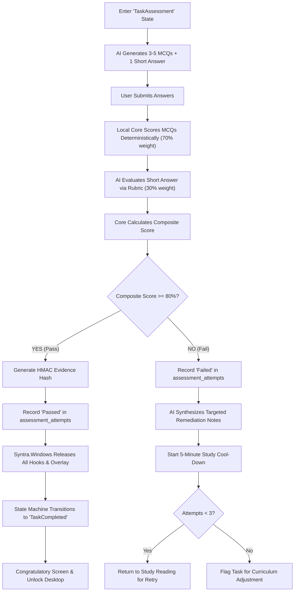
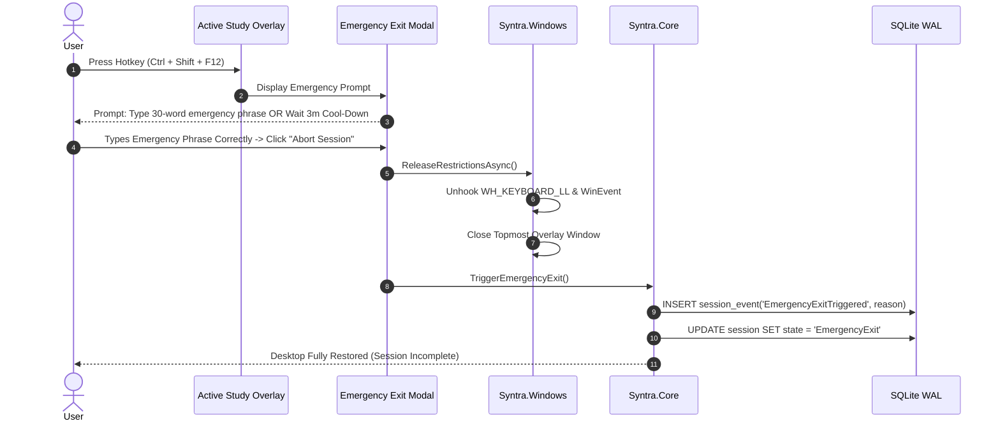
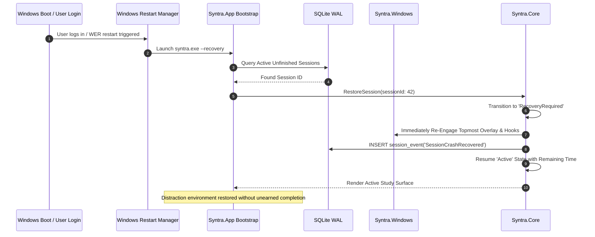

# SYNTRA — User Flows & State Journeys

---

## 1. Onboarding & First-Run Setup Flow

---

## 2. Learning Material Ingestion Flow

---

## 3. Active Study Session & Enforcement Flow

---

## 4. Assessment, Deterministic Scoring & Unlock Flow

---

## 5. Emergency Exit Flow

---

## 6. Crash & Unexpected Reboot Recovery Flow

