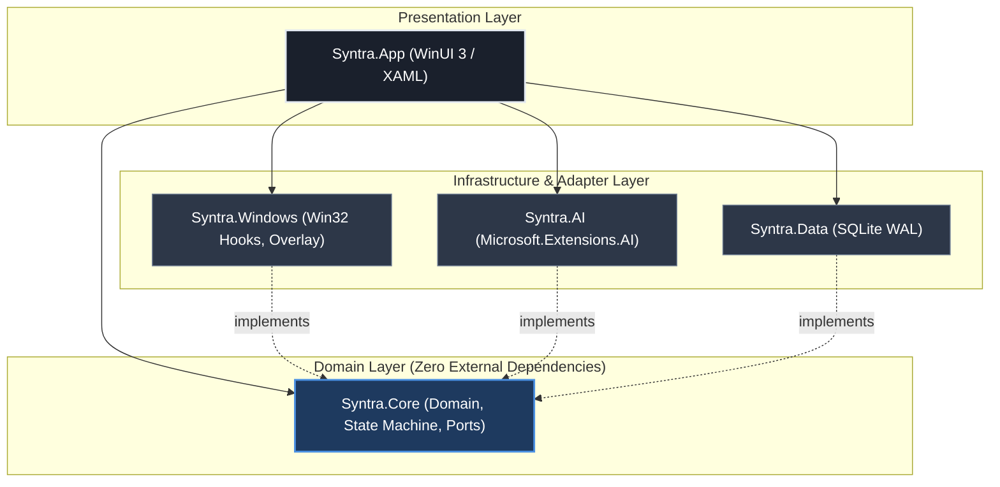
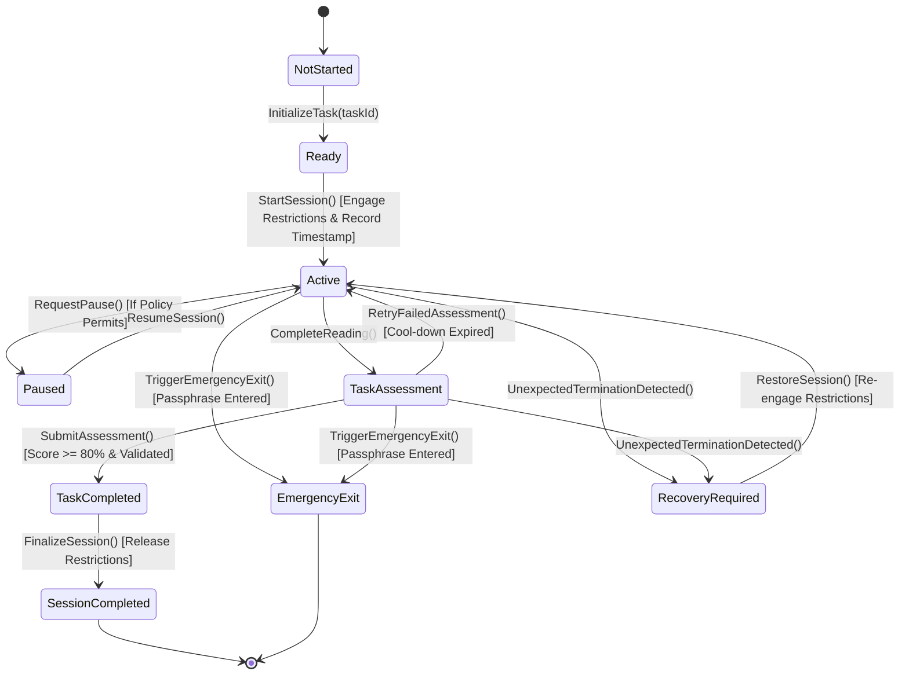
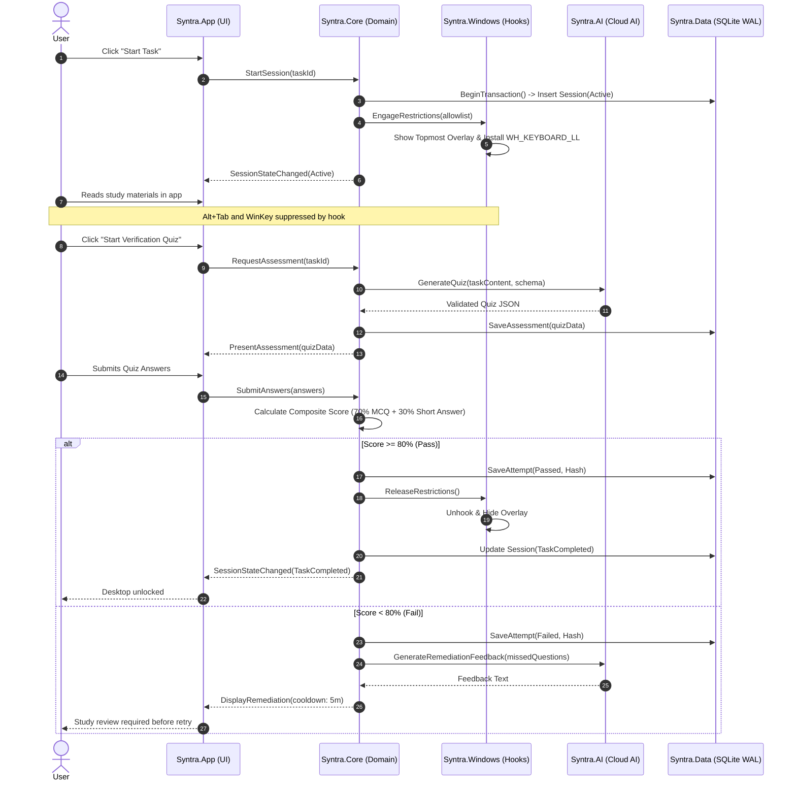

# SYNTRA — System Architecture

**Stack:** .NET 8 LTS (Clean Architecture / Ports & Adapters)  
**Target:** Windows 11 Home (64-bit x64 / ARM64)  

---

## 1. Architectural Overview

SYNTRA separates business logic, desktop UI, Windows platform hooks, local persistence, and AI providers into isolated layers:



### Component Breakdown

| Project | Target | Dependencies | Responsibilities |
|---|---|---|---|
| **`Syntra.Core`** | `net8.0` | None (pure BCL) | • Session state machine (`SessionStateMachine`)<br>• Entities: `StudyProfile`, `StudyPlan`, `StudyTask`, `StudySession`, `Assessment`<br>• Scoring calculation & validation rules<br>• Ports: `IStudySessionRepository`, `IAiPlanningService`, `IAiAssessmentService`, `IWindowsRestrictionService`, `IClock` |
| **`Syntra.App`** | `net8.0-windows10.0.19041.0` | WinUI 3, Windows App SDK 1.5+, CommunityToolkit.Mvvm | • Desktop shell & views (Dashboard, Study Overlay, Quiz Runner)<br>• ViewModels and UI state<br>• DI container configuration |
| **`Syntra.Windows`** | `net8.0-windows10.0.19041.0` | P/Invoke (CsWin32 / Vanara), Win32 User32/Kernel32 | • Implementation of `IWindowsRestrictionService`<br>• Fullscreen Topmost window (`WS_EX_TOPMOST`)<br>• Foreground tracking (`SetWinEventHook`)<br>• Low-level keyboard hook (`WH_KEYBOARD_LL`)<br>• Restart registration (`RegisterApplicationRestart`) |
| **`Syntra.AI`** | `net8.0` | `Microsoft.Extensions.AI`, `System.Text.Json` | • Implementation of `IAiPlanningService` and `IAiAssessmentService`<br>• `IChatClient` connectors (OpenAI, Gemini, Anthropic, Azure)<br>• JSON Schema validation and bounds checking<br>• Delimiter fencing prompt sanitizers |
| **`Syntra.Data`** | `net8.0` | `Microsoft.Data.Sqlite`, `Dapper` | • Implementation of repository ports<br>• SQLite connection management in WAL mode<br>• Database migrations and immutable audit logging |

---

## 2. Session State Machine & Completion Authority

The `SessionStateMachine` in `Syntra.Core` is the single source of truth for task progress. No UI click or AI response can bypass this state machine.



### Transition Invariants
- `TaskCompleted` requires a cryptographically validated passing attempt record (composite score >= 80.0%).
- Elapsed timer expiration **never** triggers `TaskCompleted`.
- An invalid or unvalidated AI response payload throws `InvalidAiPayloadException` and keeps the session in `TaskAssessment`.
- Inconsistent state snapshots on boot force the state machine into `RecoveryRequired`.

---

## 3. End-to-End Data Flow



---

## 4. Local Persistence & Crash Recovery

SYNTRA uses local SQLite configured in WAL mode:
```sql
PRAGMA journal_mode = WAL;
PRAGMA synchronous = NORMAL;
PRAGMA foreign_keys = ON;
PRAGMA busy_timeout = 5000;
```

### Recovery Protocol
1. **Immediate commits:** All session state transitions are written to disk inside atomic database transactions before the UI is notified.
2. **Restart Manager:** On startup, `Syntra.Windows` invokes:
   ```csharp
   RegisterApplicationRestart(pwzCommandLine: "--recovery", dwFlags: 0);
   ```
3. **Boot inspection:** When launched:
   ```sql
   SELECT id, current_state, task_id, started_at_utc 
   FROM sessions 
   WHERE current_state IN ('Active', 'TaskAssessment', 'Paused');
   ```
   If an active record exists, SYNTRA boots directly into `RecoveryRequired`, re-engages restriction hooks, and executes deterministic recovery based on the interrupted state:
   - **Interrupted during `Active`:** Restores active study view with remaining time recorded prior to the crash. Restrictions remain engaged.
   - **Interrupted during `TaskAssessment`:** Any partial, uncommitted quiz attempt is marked `Interrupted` in `assessment_attempts`. To prevent unearned passes or cheating via forced crash, a fresh assessment variant is generated. The interrupted attempt does not count against the 3-attempt failure quota. Restrictions remain engaged until the fresh assessment is passed.
   - **Interrupted during `Paused`:** Restores session in paused state if within pause duration budget, otherwise prompts user to resume study or transition to assessment.
   - **Database inconsistency:** If state snapshot hash fails verification, session transitions to safe recovery state with diagnostic audit logging rather than granting completion.

---

## 5. Windows Restriction Boundary (`Syntra.Windows`)

Win32 APIs are isolated behind `IWindowsRestrictionService`:

```csharp
namespace Syntra.Core.Ports;

public interface IWindowsRestrictionService
{
    ValueTask EngageRestrictionsAsync(RestrictionOptions options, CancellationToken ct = default);
    ValueTask ReleaseRestrictionsAsync(CancellationToken ct = default);
    bool IsEngaged { get; }
    event EventHandler<RestrictionBreachEventArgs>? OnBreachAttempted;
}
```

Win32 mechanisms used:
- `CreateWindowEx(WS_EX_TOPMOST, ...)`: Fullscreen borderless window covering all active displays (`EnumDisplayMonitors`).
- `SetWindowsHookEx(WH_KEYBOARD_LL, ...)`: Suppresses `VK_LWIN`, `VK_RWIN`, `Alt+Tab`, `Alt+Esc`, `Ctrl+Esc`. Callback runs in < 0.5 ms.
- `SetWinEventHook(EVENT_SYSTEM_FOREGROUND, ...)`: Re-asserts SYNTRA window if a background app steals focus.
- `RegisterApplicationRestart("--recovery", 0)`: WER and reboot restart registration.
- In-app emergency hatch: `Ctrl+Shift+F12` invokes a passphrase modal to cleanly release all hooks during an emergency.
