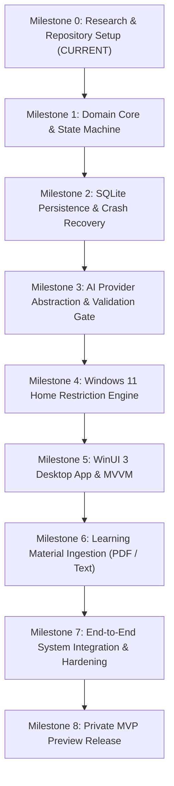
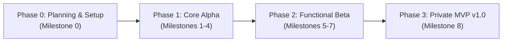

# SYNTRA — Implementation Roadmap & Release Plan

**Current Phase:** Milestone 0 (Planning & Architecture)  
**Target Platform:** Windows 11 Home (64-bit x64 / ARM64)  
**Execution:** Milestone-Gated, Test-Driven Development  

---

## 1. Development Principles & Milestone Gates

SYNTRA follows a strict **architecture-first, zero-premature-code** policy.
- No code will be written in `src/` or `tests/` until Milestone 0 is approved.
- Each milestone contains explicit **Dependencies**, **Deliverables**, **Acceptance Criteria**, **Testing Requirements**, **Security Checks**, and **Exit Criteria**.
- Progression from one milestone to the next requires satisfying all exit criteria and running automated verification suites.



---

## 2. Milestone Breakdown

### Milestone 0: Research, Architecture & Repository Setup (CURRENT)
- **Objective:** Establish the complete architectural foundation, verified technical constraints on Windows 11 Home, AI abstraction designs, threat modeling, and repository configurations.
- **Dependencies:** None.
- **Deliverables:** Complete documentation suite under `docs/` and repository workflow configurations.
- **Exit Criteria:** All technical documentation complete, verified, and cross-linked.

### Milestone 1: Domain Core & Session State Machine
- **Objective:** Implement the pure .NET 8 domain layer, domain models, value objects, and the `SessionStateMachine`.
- **Dependencies:** Milestone 0 approval.
- **Deliverables:**
  - Project `src/Syntra.Core` targeting `net8.0` with zero external package dependencies.
  - Entities: `StudyProfile`, `StudyPlan`, `StudyTask`, `StudySession`, `Assessment`, `AssessmentAttempt`.
  - State Machine: `SessionStateMachine` enforcing states (`NotStarted`, `Ready`, `Active`, `Paused`, `TaskAssessment`, `TaskCompleted`, `SessionCompleted`, `EmergencyExit`, `RecoveryRequired`).
  - Core Ports: `IStudySessionRepository`, `IAiPlanningService`, `IAiAssessmentService`, `IWindowsRestrictionService`, `IClock`.
  - Test Suite: `tests/Syntra.Core.Tests` using `xUnit` and `FluentAssertions`.
- **Exit Criteria:** 100% unit test branch coverage across `SessionStateMachine` and deterministic scoring rules.

### Milestone 2: SQLite Persistence & Crash Recovery
- **Objective:** Implement local relational persistence using SQLite in WAL mode with transactional state snapshots and crash recovery queries.
- **Dependencies:** Milestone 1.
- **Deliverables:**
  - Project `src/Syntra.Data` targeting `net8.0`.
  - SQLite database initializer, schema creation scripts, and migration runner.
  - Repository implementations: `SqliteStudySessionRepository`, `SqliteProfileRepository`, `SqliteMaterialRepository`.
  - Transactional event logging (`session_events` audit table).
  - Test Suite: `tests/Syntra.Integration.Tests` testing data persistence against SQLite in WAL mode.
- **Exit Criteria:** Recovery drills prove state restoration after simulated process termination.

### Milestone 3: AI Provider Abstraction & Validation Gate
- **Objective:** Implement the provider-independent AI layer with JSON schema bounds validation and delimiter prompt injection defenses.
- **Dependencies:** Milestone 1.
- **Deliverables:**
  - Project `src/Syntra.AI` targeting `net8.0`.
  - Implementations: `OpenAiChatClient`, `AnthropicChatClient`, `GeminiChatClient`, and `MockChatClient` via `Microsoft.Extensions.AI`.
  - Schema validators for `StudyPlanDto` and `QuizAssessmentDto`.
  - Delimiter fencing prompt builders.
  - Polly resilience policies (jittered exponential backoff).
- **Exit Criteria:** AI tests pass using `MockChatClient`; malformed JSON payloads fail safely.

### Milestone 4: Windows 11 Home Restriction Engine
- **Objective:** Implement user-mode distraction barriers (`WS_EX_TOPMOST`, `SetWinEventHook`, `WH_KEYBOARD_LL`, `RegisterApplicationRestart`).
- **Dependencies:** Milestone 1.
- **Deliverables:**
  - Project `src/Syntra.Windows` targeting `net8.0-windows10.0.19041.0`.
  - Implementation: `WindowsRestrictionService` implementing `IWindowsRestrictionService`.
  - Fullscreen borderless Topmost window (`WS_EX_TOPMOST`) for primary and secondary monitors.
  - Foreground monitor (`SetWinEventHook` on `EVENT_SYSTEM_FOREGROUND`).
  - Low-level keyboard hook (`SetWindowsHookEx` on `WH_KEYBOARD_LL`) suppressing `WinKey`, `Alt+Tab`, `Alt+Esc`, `Ctrl+Esc`.
  - Windows Restart Manager registration (`RegisterApplicationRestart`).
  - Emergency exit hatch handler (passphrase challenge + cool-down timer).
- **Exit Criteria:** Callback latency under 1.0 ms; emergency exit verified; no elevation required.

### Milestone 5: WinUI 3 Desktop App & MVVM Presentation
- **Objective:** Build the modern fluent desktop interface using WinUI 3 and Windows App SDK.
- **Dependencies:** Milestones 1, 2, 3, 4.
- **Deliverables:**
  - Project `src/Syntra.App` targeting `net8.0-windows10.0.19041.0`.
  - ViewModels: `DashboardViewModel`, `SessionViewModel`, `AssessmentViewModel`, `MaterialsViewModel`, `SettingsViewModel`.
  - Fluent XAML Views: Dark theme styling, high-contrast support, responsive layouts.
  - Dependency Injection setup via `Microsoft.Extensions.DependencyInjection`.
- **Exit Criteria:** Cold startup under 1.5s; WCAG 2.1 AA accessibility verified.

### Milestone 6: Learning Material Ingestion Engine
- **Objective:** Implement local document parsing and semantic chunking for Markdown, Text, and PDF files.
- **Dependencies:** Milestone 1, 2.
- **Deliverables:**
  - Integration of `UglyToad.PdfPig` (Apache 2.0) in pure C#.
  - Document parser extracting plain text, titles, headings, and code blocks.
  - Semantic sliding-window chunker (1,500–2,500 tokens with 200-token overlap).
  - Error reporter recording parsing anomalies without fabricating missing text.
- **Exit Criteria:** Parses 100+ page technical PDFs cleanly in under 5 seconds with zero native DLLs.

### Milestone 7: End-to-End System Integration & Hardening
- **Objective:** Wire all components together, perform end-to-end user journey validation, simulate crashes, and conduct security reviews.
- **Dependencies:** Milestones 1 through 6.
- **Deliverables:**
  - Complete end-to-end integration test suite (`Syntra.Integration.Tests`).
  - Crash recovery drill: simulated power loss / forced process kill during assessment.
  - Performance profiling (memory leak analysis, hook latency, CPU utilization).
- **Exit Criteria:** Zero data loss or unearned completion on crash recovery; CPU < 1.0% and RAM < 120 MB.

### Milestone 8: Private MVP Preview Release
- **Objective:** Package the application for private personal testing on Windows 11 Home.
- **Dependencies:** Milestone 7.
- **Deliverables:**
  - Self-contained MSIX installer package and standalone unpackaged distribution.
  - Setup and onboarding documentation.
- **Exit Criteria:** Installs cleanly on a clean Windows 11 Home test machine without developer tools.

---

## 3. Packaging, Delivery & Signing Strategy



### Packaging Targets
1. **Primary Target: MSIX Package (`.msix`):**
   - Bundles Windows App SDK runtime, isolated registry, automatic protocol registration.
   - Signed with local developer certificate in `Cert:\CurrentUser\TrustedPeople` during private testing.
2. **Secondary Target: Self-Contained Unpackaged Distribution (`.zip`):**
   ```bash
   dotnet publish src/Syntra.App/Syntra.App.csproj \
     -c Release \
     -r win-x64 \
     --self-contained true \
     -p:WindowsAppSDKSelfContained=true
   ```
   - Runs directly from a folder without developer mode enabled.

### Code Signing & Trust Strategy
- **Private Alpha / MVP Phase:**
  - Self-signed developer certificate created via PowerShell:
    ```powershell
    New-SelfSignedCertificate -Type Custom -Subject "CN=SyntraDev" `
      -KeyUsage DigitalSignature -FriendlyName "SYNTRA Development Certificate" `
      -CertStoreLocation "Cert:\CurrentUser\My"
    ```
  - Export and install certificate to `Cert:\CurrentUser\TrustedPeople`.
  - Sign MSIX packages via `SignTool.exe`.
- **Future Distribution Phase:**
  - Transition to Microsoft Azure Trusted Signing or EV certificate.

---

## 4. Release Checklist & Rollout Verification

Before any private MVP release build is distributed:
- [ ] **Clean Build:** `dotnet build -c Release` completes with 0 Warnings, 0 Errors.
- [ ] **Automated Tests:** All unit and integration tests pass cleanly via `dotnet test`.
- [ ] **Secret Hygiene Audit:** Verify zero API keys or personal credentials exist in binaries or configs.
- [ ] **Clean Uninstall Test:** Verify uninstall removes local database files and releases `RegisterApplicationRestart` entries.
- [ ] **Crash Recovery Drill:** Simulate forced termination (`taskkill /F /IM syntra.exe`) during an active study task and verify restart recovery.
- [ ] **Emergency Exit Drill:** Verify `Ctrl+Shift+F12` cleanly releases hooks and restores desktop.
